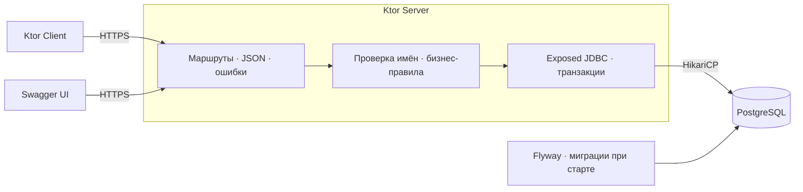

<div align="center">

# KateMedia · Counters API

**Именованные счётчики. Атомарные обновления. Проверяемые гарантии.**

[](https://github.com/kinyha/kate-media-exercise/actions/workflows/ci.yml)


Тестовое задание: HTTPS REST API для именованных счётчиков `Dictionary<String, Int>`.

</div>

## Соответствие заданию

| | Требование | Реализация и проверка |
|---|---|---|
| ✓ | Пять операций и REST-семантика | [ApiContractTest] проверяет создание, чтение, список, инкремент и удаление: тела, статусы и `Location`. Контракт и обоснование — [ниже](#api-и-принятые-решения). |
| ✓ | Exposed, СУБД, схема и сохранность данных | PostgreSQL 17 + Exposed JDBC, без состояния в памяти; [миграция Flyway][migration]. [ConcurrencyE2eTest] проверяет сохранение `41` после перезапуска приложений и БД. |
| ✓ | Нет потерянных инкрементов | Exposed `updateReturning` выполняет атомарный `UPDATE`. [ConcurrencyE2eTest] отправляет 1000 инкрементов и проверяет итог `начальное + 1000`. |
| ✓ | Каждый инкремент возвращает уникальное значение | `RETURNING` читает результат своего обновления. Тот же тест сравнивает **все ответы** с ожидаемым диапазоном: без повторов и пропусков. |
| ✓ | При создании побеждает один запрос | Первичный ключ по имени. [ConcurrencyE2eTest]: 100 созданий одного имени → один успех, 99 ответов `409`, одна запись со значением победителя. |
| ✓ | Модели kotlinx.serialization | Общие [DTO][models]. [RequestSerializationTest] проверяет типы, лишние поля, границы `Int` и Unicode; [ApiContractTest] — обязательные поля и ошибки HTTP. |
| ✓ | Kotlin, Ktor и HTTPS | Сервер и клиент на Ktor. [ConcurrencyE2eTest] работает по HTTPS, проверяет доверие сертификату и имя хоста. |
| ✓ | Клиент или Swagger UI | Есть оба. [ConcurrencyE2eTest] запускает CLI-демонстрацию; [OpenApiTest] проверяет спецификацию и набор маршрутов. |

## Запуск и проверка вручную

Достаточно Docker с Compose v2; Java и Gradle на хосте для этого не нужны. Из корня проекта:

```bash
docker compose up --build -d --wait --wait-timeout 180
docker compose run --rm client demo
```

Compose поднимает БД, генерирует сертификат и применяет миграции. `demo` выполняет все пять операций: создание с `41`, чтение, инкремент до `42`, список, удаление.

**[Swagger UI](https://localhost:8443/swagger)** — ручная проверка через **Try it out**. Добавьте исключение для самоподписанного сертификата в браузере; клиент в Compose уже доверяет ему.

Отдельные команды клиента:

```bash
docker compose run --rm client create orders 0
docker compose run --rm client get orders
docker compose run --rm client increment orders
docker compose run --rm client list
docker compose run --rm client delete orders
```

Остановка: `docker compose down`; данные сохраняются. Флаг `-v` удаляет данные и сертификат. Настройки и локальные пароли — в [.env.example](.env.example), для изменения скопируйте в `.env`.

## API и принятые решения

Создание: `Content-Type: application/json`, тело `{"name":"views","value":10}`. Ответ со счётчиком имеет тот же формат; инкремент вернёт `{"name":"views","value":11}`.

| Метод и путь | Успешный ответ | Ошибки запроса |
|---|---|---|
| `POST /counters` | `201`, счётчик и заголовок `Location` | `400` — некорректное тело или имя; `409` — имя занято; `415` — неподдерживаемый тип тела |
| `GET /counters` | `200`, массив счётчиков по имени; `[]`, если пусто | — |
| `GET /counters/{name}` | `200`, счётчик | `400` — некорректное имя; `404` — счётчика нет |
| `POST /counters/{name}/increment` | `200`, счётчик с новым значением | `400` — некорректное имя; `404` — счётчика нет; `409` — переполнение `Int` |
| `DELETE /counters/{name}` | `204`, без тела | `400` — некорректное имя; `404` — счётчика нет |

`GET` безопасен и идемпотентен. Создание через `POST` не перезаписывает существующий счётчик. Инкремент — `POST`, поскольку каждый вызов меняет значение и не идемпотентен. `DELETE` идемпотентен по состоянию: счётчик остаётся удалённым, хотя повторный запрос получает `404` вместо `204`.

**Валидация.** Оба поля обязательны, неизвестные поля запрещены. `value` — знаковый 32-битный `Int`: строки, дроби и числа вне диапазона отклоняются. Имя чувствительно к регистру, содержит 1–255 Unicode-символов; запрещены полностью пробельные имена, `/`, управляющие символы, `.` и `..`. В URL имя нужно кодировать; клиент делает это автоматически.

**Ошибки:** `{"code":"COUNTER_NOT_FOUND","message":"Counter not found"}`. Недоступность БД или таймаут — `503 / DATABASE_UNAVAILABLE`, внутренняя ошибка — `500 / INTERNAL_ERROR` без технических деталей. Неизвестный маршрут — `404`, неподдерживаемый метод — `405` с `Allow`. Все коды и модели — в [openapi.yaml](server/src/main/resources/openapi.yaml).

## Почему конкурентные запросы корректны

В [PostgresCounterRepository] инкремент выполняется через Exposed одним SQL-оператором:

```sql
UPDATE counters SET value = value + 1 WHERE name = ? RETURNING name, value;
```

PostgreSQL блокирует строку до конца транзакции: следующий инкремент видит обновлённое значение. `RETURNING` читается внутри транзакции, ответ отправляется после commit. Поэтому обновления не теряются, а ответы уникальны даже при нескольких процессах приложения.

Первичный ключ исключает дубликаты имён. Переполнение `INTEGER` откатывает операцию и даёт `409`; ошибки определяются по SQLSTATE. Автоматические повторы транзакций отключены.

**Условия E2E-проверки:** реальная PostgreSQL, HTTPS, отдельные контейнеры приложения. 1000 инкрементов выполняются при 1, 8 и 32 исполнителях для одного и двух процессов. Общий барьер синхронизирует старт; проверки результата указаны в чек-листе.

Дополнительно E2E проверяет независимые счётчики, переполнение, гонку удаления и инкрементов, восстановление БД. [RepositoryTest] подтверждает ожидание блокировки через `pg_stat_activity`: после rollback ожидавший инкремент получает `11` из исходного `10`, не увидев незакоммиченное `100`.

Гарантия уникальности относится к одной жизни счётчика: после удаления и повторного создания значения могут повториться. При потере ответа после commit повторный `POST` будет новой операцией; idempotency keys не реализованы.

## Запуск тестов

Нужен JDK 21. Для интеграционных и E2E-тестов также нужен запущенный Docker; тестовое окружение создаёт Testcontainers, запускать Compose заранее не требуется.

```bash
./gradlew test                     # сериализация, клиент, конфигурация, OpenAPI; без Docker
./gradlew :server:integrationTest  # контракт API, репозиторий и миграции на PostgreSQL
./gradlew :server:e2eTest          # HTTPS, конкурентные запросы и перезапуски контейнеров
./gradlew check                   # все тесты + ktlint и detekt
```

[CI](https://github.com/kinyha/kate-media-exercise/actions/workflows/ci.yml) также собирает покрытие и проверяет Compose. Отчёты — в `<module>/build/reports/tests/`, логи E2E — в `server/build/e2e-logs/`.

Код разделён на три модуля: [api-models](api-models) — общие DTO и сериализация, [server](server) — API и работа с БД, [client](client) — Ktor-клиент и CLI, используемые также в E2E.



[ApiContractTest]: server/src/test/kotlin/dev/kinyha/counters/server/ApiContractTest.kt
[ConcurrencyE2eTest]: server/src/test/kotlin/dev/kinyha/counters/server/ConcurrencyE2eTest.kt
[RepositoryTest]: server/src/test/kotlin/dev/kinyha/counters/server/RepositoryTest.kt
[RequestSerializationTest]: api-models/src/test/kotlin/dev/kinyha/counters/api/RequestSerializationTest.kt
[OpenApiTest]: server/src/test/kotlin/dev/kinyha/counters/server/OpenApiTest.kt
[PostgresCounterRepository]: server/src/main/kotlin/dev/kinyha/counters/server/PostgresCounterRepository.kt
[models]: api-models/src/main/kotlin/dev/kinyha/counters/api/Models.kt
[migration]: server/src/main/resources/db/migration/V1__create_counters.sql
